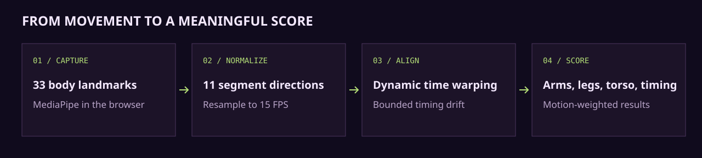
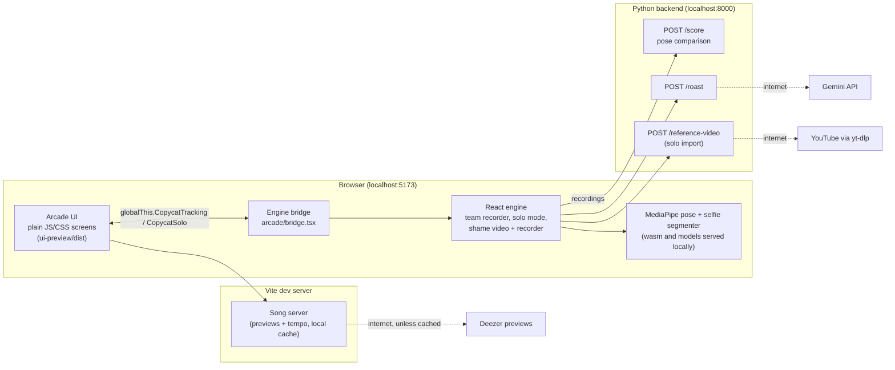

<p align="center">
  <a href="https://www.youtube.com/watch?v=rx7CTy5sJz8"></a>
</p>

# Copycat

**Turn your living room into a motion-tracked dance arcade.**

Create a dance. Challenge your friends to copy it. Let computer vision settle the score—and turn the final standings into a downloadable, AI-written breaking-news finale.

Built by a four-person team in **36 hours at Hack Western 13**, November 20–22, 2026. This is **Liangray Li's portfolio fork** of [jtam-western/Copycat](https://github.com/jtam-western/Copycat), preserving the original project and its contributor history.

[Watch the demo](https://www.youtube.com/watch?v=rx7CTy5sJz8) · [Devpost submission](https://devpost.com/software/copycat-68dxit) · [Explore my contribution](#my-contribution--liangray-li) · [Under the hood](#engineering-highlights) · [Run locally](#running-it-locally) · [Meet the team](#team)

## The experience

| Play | What happens |
| --- | --- |
| **Create and compete** | 2–4 players share a laptop and webcam. Record a 10-second dance, rotate the creator role, and compete on how closely you reproduce each other's moves. |
| **See the movement** | A mirrored skeleton replay and synchronized guide help players learn and follow the reference dance. |
| **Get a meaningful score** | Body-segment comparison and dynamic time warping produce scores for arms, legs, torso, and timing. |
| **Practice solo** | Import a local video or a section of a YouTube dance, then review a synchronized replay with pose-error highlights. |
| **Finish with a story** | The lowest-scoring player gets a breaking-news finale with a generated headline, composited dance footage, and a video download. |

## My contribution — Liangray Li

I worked on the **arcade experience and music discovery layer**, translating the team's pose-tracking game into an interface people could pick up and play.

- **Arcade UI and visual direction:** designed the game screens in HTML, CSS, and JavaScript, including the lobby, gameplay presentation, and finale design.
- **Lobby and character customization:** built the player setup experience and avatar selection.
- **Tempo picker and beat guide:** created controls and visual timing cues to help players choose a pace and follow the beat.
- **Song catalog and preview server:** worked on the song selection experience and the server that fetches previews, detects tempo, and caches audio locally.
- **Chiptune and menu music integration:** integrated the audio presentation, with source artists credited below.

The original team documentation records these responsibilities in [AGENTS.md](AGENTS.md#who-owns-what) and the [team credits](#team). The pose-scoring backend, engine bridge, solo replay system, and video compositor were collaborative project features owned by other teammates, as detailed below.

**Selected implementation:** [Arcade screens](frontend/src/game/ui-preview/dist/) · [Player lobby](frontend/src/game/ui-preview/dist/lobby.js) · [Beat guide](frontend/src/game/ui-preview/dist/team.css) · [Song server](frontend/songServer.ts)

## Engineering highlights



- **Movement comparison across players.** The scorer compares limb directions instead of raw screen positions, reducing sensitivity to where a player stands and their apparent size.
- **Timing-aware alignment.** Bounded dynamic time warping accommodates small delays while a separate timing score rewards staying in sync.
- **Browser-based computer vision.** MediaPipe extracts poses and segments the player for the finale. Models and WebAssembly assets are served locally.
- **A bridge between custom UI and React.** Plain JavaScript arcade screens communicate with the React recording and gameplay engine through explicit shared interfaces.
- **Resilient demo behavior.** Cached song previews, bundled music, local vision models, and canned roast headlines keep core gameplay usable without internet when both app servers run locally.
- **A recorded finale.** Canvas compositing, MediaRecorder, and Web Audio turn the end-of-game reveal into a downloadable video.

> The cover shows actual gameplay from our [Devpost gallery](https://devpost.com/software/copycat-68dxit); the scoring pipeline is an implementation diagram. This is a hackathon prototype; local setup provides the complete experience. See [known limitations](#known-limitations) for deployment and tracking constraints.

---

## How a game works

### Team play (2 to 4 players)

1. Players enter names and pick avatars in the lobby, then pass a camera check and choose a song
   or tempo.
2. Each round has a **creator**. They record a 10-second dance after a 3-2-1 countdown.
3. Every other player takes a turn as a **copier**. They first watch the creator's dance played back
   as a skeleton (mirrored, like a dance mirror), then press **Your turn: start copying** and copy it
   while a small synced skeleton guide plays alongside.
4. Each copy is sent to the backend and scored out of 100, with a breakdown for arms, legs, torso
   and timing.
5. The creator role rotates, so every player creates once. After each round a leaderboard shows the
   running averages. Players can carry on with **Next round** or stop early with **End game**.
6. When the game ends, the player with the lowest average (timing breaks ties) gets the finale: a
   short **breaking news** video with their dance cut out of the camera footage and pasted into a
   reaction clip, plus a Gemini-written headline. The finale screen then shows the final standings
   and a **Download video** button that saves the breaking-news video to the device.

Players without a scored attempt can't be picked as the loser. If nobody has a score yet, End game
just returns to the menu.

### Solo mode

Solo is a practice mode against a reference dance instead of a friend. Import a 5 to 60 second
section of a YouTube dance video (or pick a local MP4), preview it, and dance along. You get a live
rating during the turn, an official score at the end, and a replay timeline that lines up your
camera footage with the reference and highlights the moments where your pose drifted.

## How scoring works

Scoring runs on the backend (`backend/scoring.py`). The browser only records poses.

1. **Pose tracking.** In the browser, MediaPipe's pose landmarker finds 33 body landmarks per camera
   frame. A recording is a list of timestamped landmark frames, about 10 seconds long.
2. **Limb directions, not positions.** Each frame is turned into the direction of 11 body segments
   (upper arms, forearms, thighs, shins, the shoulder line, the hip line and the spine). Comparing
   directions instead of raw positions means height, distance from the camera and where you stand
   in the frame don't matter. Landmarks with low visibility are ignored.
3. **Resampling.** Both recordings are resampled onto the same 15 frames-per-second grid, so cameras
   and devices with different frame rates compare fairly.
4. **Dynamic time warping.** DTW lines the copy up with the original, so a copier who is a beat late
   still gets credit for the right moves. The alignment may drift at most one second off the
   diagonal.
5. **Per-limb scores.** Along the aligned path, each segment's average angle error becomes a 0 to 100
   score: within 10 degrees is perfect, and 60 degrees or worse is zero. Arms, legs and torso are the
   averages of their segments.
6. **Weighting.** Limbs that barely move in the original count less, so a dance that is all arms is
   mostly judged on arms.
7. **Timing.** The timing score measures how far the alignment strays from "the same moment in both
   recordings" (a one-second average lag scores zero). It can lift or lower the pose score by up to
   30 percent, but it can't rescue a bad copy:
   `total = pose x (0.7 + 0.3 x timing / 100)`.
8. **Worst moment.** The scorer smooths the per-frame error and reports the worst body part and the
   worst moment (a timestamp in each recording), along with the best moment.

If a recording doesn't have enough usable frames, the backend answers with a friendly message that
says who should redo their take (the creator or the copier).

### The roast

At the end of the game the frontend sends the loser's averages and worst body part to `/roast`.
The backend asks Gemini (`gemini-3.5-flash-lite` by default) for a short `BREAKING:` headline and a
one-line roast about the dancing, never the person. The output is validated and the call times out
after 8 seconds. If there is no API key, no internet or a bad answer, the backend returns a canned
headline instead, so `/roast` always succeeds.

## Architecture



Solid lines run on the laptop. Dotted lines need the internet, and each has a local fallback (see
[Offline mode](#offline-mode)).

- The **arcade UI** is Liangray's plain HTML, CSS and JavaScript (`frontend/src/game/ui-preview/dist`),
  served as Vite's public folder. It draws every screen.
- The **engine bridge** (`frontend/src/arcade/bridge.tsx`) exposes the React engine to those scripts
  through `globalThis.CopycatTracking` (mount a team turn, score, roast, play the finale video) and
  `globalThis.CopycatSolo` (mount solo mode).
- The **backend** is a small FastAPI app. The request and response formats live in
  [CONTRACT.md](CONTRACT.md).

## Tech stack

- **Frontend:** TypeScript, React 19, Vite 8, plain JavaScript and CSS for the arcade screens
- **Computer vision:** MediaPipe Tasks Vision 1.2.3 (pose landmarker lite, selfie segmenter)
- **Media:** MediaRecorder, canvas `captureStream` and the Web Audio API for the recorded finale video
  and the generated news sting
- **Backend:** Python, FastAPI, NumPy, Uvicorn
- **AI:** Google Gemini via the `google-genai` SDK
- **Tools:** FFmpeg (song previews and solo imports), yt-dlp (solo YouTube imports), ESLint,
  pytest and Node's built-in test runner

## Running it locally

### Prerequisites

- Python 3.11 or newer
- Node.js 22.18 or newer (the song caching script runs TypeScript directly)
- A webcam
- Optional, for solo YouTube imports: `yt-dlp` and FFmpeg on your PATH (on macOS:
  `brew install yt-dlp ffmpeg`)
- Optional: a Gemini API key from <https://aistudio.google.com/apikey>

### Backend

```bash
cd backend
python3 -m venv .venv
.venv/bin/pip install -r requirements.txt
cp .env.example .env   # then put your key in GEMINI_API_KEY (optional)
.venv/bin/uvicorn main:app --port 8000
```

Without a key, `/roast` still works and uses canned headlines. `.env` is gitignored; never commit it.

### Frontend

In a second terminal:

```bash
cd frontend
npm install
npm run dev
```

Open the address Vite prints (usually <http://localhost:5173>). The frontend expects the backend at
`http://localhost:8000`. To use another backend, set `VITE_API_URL` before `npm run dev`.

### Caching demo songs

The song picker plays 30-second previews fetched from Deezer through the Vite server. To make a set
of songs play without internet, cache them ahead of time:

```bash
cd frontend
npm run songs:cache               # every song listed in demo-songs.json
npm run songs:cache -- 884025     # or specific catalog IDs
```

Cached previews go in `frontend/.song-cache/`, which is gitignored. Song files must never be committed.

### Adding reaction clips for the breaking-news video

The breaking-news video pastes the loser into a reaction clip. Clips are not included in the repo.
Put any `.mp4` files in `frontend/public/shame-clips/` (the videos are gitignored). Optionally,
describe each clip in `frontend/public/shame-clips/clips.json`, which is committed:

```json
[
  { "file": "shamevid1.mp4", "start": 0, "insertAt": 19, "end": 28.3,
    "loser": { "x": 0.43, "feetY": 0.74, "height": 0.5 } }
]
```

- `start` and `end`: the part of the clip that plays, in seconds. It plays in full, then the finale
  screen shows.
- `insertAt`: when the cut-out loser appears and starts dancing.
- `loser`: where they stand, as fractions of the clip's frame. `x` is their horizontal centre,
  `feetY` is where their feet touch the floor and `height` is their height. Keep `feetY` above about
  0.75 so the news banner doesn't cover their feet.

With clips that have no entry, the video lasts about 14 seconds and the loser stands in the
lower-right corner.
With no clips at all, the loser dances over a dark BREAKING NEWS background.

### Mock mode

Open <http://localhost:5173/?mock=1> to play without a camera. Turns produce fake recordings that are
still scored by the real backend, which is handy for testing the game flow.

### Tests

```bash
cd backend
.venv/bin/python -m pytest -q
```

```bash
cd frontend
npm run lint
npm run build
node --test $(find src -name "*.test.mjs" -o -name "*.test.cjs")
```

The backend tests mock Gemini, so they never call the real API.

## Offline mode

With the frontend and backend running on the same laptop, the game works without internet:

- Pose tracking, the team recorder, scoring, the breaking-news video and its download all run
  locally. The MediaPipe wasm and both models are served by the app itself.
- The roast falls back to canned headlines when Gemini can't be reached.
- Songs that were cached with `npm run songs:cache` play as normal. Uncached songs fall back to the
  bundled chiptune loop closest to the chosen tempo.
- Solo YouTube imports need internet. Picking a local MP4 still works.

## Project structure

```text
backend/
  main.py                 FastAPI app: /health, /score, /roast, /reference-video
  scoring.py              pose comparison (limb directions, resampling, DTW, scores)
  roast.py                Gemini headline with a canned fallback
  reference_video.py      solo YouTube import with yt-dlp and FFmpeg
  test_*.py               pytest suite
frontend/
  vite.config.ts          serves the arcade UI, models, shame clips and the song server
  songServer.ts           Deezer preview download, tempo detection and local cache
  scripts/cache-songs.ts  npm run songs:cache
  public/models/          MediaPipe pose and segmentation models
  public/shame-clips/     reaction clips (local only) and clips.json
  src/main.tsx            entry point: loads the engine bridge
  src/arcade/             bridge to the arcade UI, mock turns
  src/game/ui-preview/dist/  arcade UI: screens, styles, fonts, music, song catalog
  src/components/Game/    team turn recorder and skeleton replay
  src/game/               solo mode (Game.tsx), API client, team turn rules, combos
  src/shame/              breaking-news video: cut-out, compositing, recording
  src/hooks/, src/utils/  pose detection, recording and reference helpers
CONTRACT.md               API and data formats
AGENTS.md                 working rules for people and coding agents
```

## Team

- **Clement Ho** ([cclementho](https://github.com/cclementho)): backend scoring engine and Gemini
  roast, game logic and End game, team recorder and the engine bridge to the arcade UI, breaking-news
  video and finale download, offline mode.
- **Johnathan Tam** ([johnathantam](https://github.com/johnathantam), jtam-western): first game MVP
  and the React port of the UI, camera check and countdown, music system and dance combos, how-to-play
  page, GitHub Pages deployment.
- **Justin Chow** ([justintimejt](https://github.com/justintimejt)): solo mode, video recording and
  replay, YouTube reference import (frontend and backend), replay timeline.
- **Liangray Li** ([PIGJET](https://github.com/PIGJET)): arcade UI design, lobby and character
  customization, tempo picker and beat guide, song catalog and preview server, chiptune and menu
  music, finale design.

## Credits and licenses

- **Gameplay and lobby music:** "33 Free Chiptune Loops" by hyperpixel
  (<https://hyperpixel.itch.io/33-free-chiptune-loops>), CC0 1.0, tempo-adjusted for each BPM step.
- **Menu music:** "Night Shade" by AdhesiveWombat.
- **Song previews:** fetched at runtime from Deezer's public API and credited on screen. No song
  audio is included in the repo; the catalog only lists track IDs, titles and artists.
- **Pose tracking and segmentation:** MediaPipe Tasks Vision and its pose landmarker lite and selfie
  segmenter models, Apache License 2.0.
- **Fonts:** Barlow and Silkscreen, SIL Open Font License 1.1 (license files in
  `frontend/src/game/ui-preview/dist/fonts/`).
- **Reaction clips** for the breaking-news video are not included and must be supplied locally.

## Known limitations

- One camera and one player in frame at a time. Copiers take turns.
- Scoring compares 2D limb directions from a single camera, so moves toward or away from the camera
  count for little, and baggy clothes or poor lighting can hurt tracking.
- A take only needs both shoulders in frame to start and keep going, so the legs score can suffer
  if a player's feet leave the frame.
- The breaking-news cut-out needs a reasonably fast laptop. Below 15 frames per second it falls back
  to showing the loser's clip in a box.
- The song server and YouTube import run on the laptop's dev server and backend. The GitHub Pages
  build needs a separately hosted backend and has no song previews.
- Built in 36 hours: there are no accounts, no saved games and no online multiplayer.
