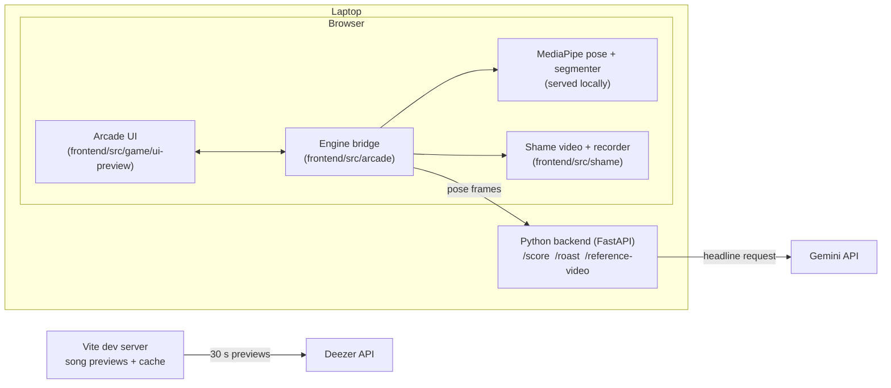

[README.md](https://github.com/user-attachments/files/35225649/README.md)
# Copycat

**Copy your friends. Get judged. Get exposed.**

Copycat is a dance party game you play on one laptop. One player records a dance, everyone else watches it and tries to copy it, and the game scores how close each copy was. Players take turns being the creator. Whoever has the lowest average at the end gets a breaking news shame video of their own worst dance.

Built at [Hack Western 13](https://hackwestern.com) (November 20 to 22, 2026).

<!-- Add a demo GIF or screenshot here -->
<!-- Devpost: add link here -->

---

## How a game works

### Team play (2 to 4 players)

1. Enter player names and pick **Quick** (one round, player 1 creates) or **Full** (everyone creates once).
2. Turn on the camera and pick a song. The beat guide follows the song's BPM.
3. **Creator's turn:** a 3-2-1 countdown, then 10 seconds to make up a dance. The game records your body movement and video.
4. **Copier's turn:** you first watch the creator's dance played back as a mirrored skeleton. Then you press start, get a countdown, and have 10 seconds to copy it. A small skeleton guide stays in the corner while you dance.
5. Each copy gets a score out of 100 with a breakdown for arms, legs, torso and timing, plus the body part you got most wrong. Live combos and hype callouts pop up while you dance.
6. Creators rotate each round. After any round you can **End game** early.
7. The player with the lowest average loses. Ties go to whoever had worse timing.

### The finale

The loser gets a **breaking news shame video**. It opens with a news intro, plays a reaction clip, and then the loser is cut out of their worst take and pasted into the clip, dancing. A Gemini-written headline and roast line run along the bottom. The video can be downloaded straight from the finale screen. Nothing is uploaded anywhere.

### Solo mode

Pick a dance clip and copy it on your own. Solo includes a pose guide, an upcoming move carousel, and a replay timeline that shows where you matched the dance and where you didn't.

---

## How scoring works

Scoring runs on the Python backend (`backend/scoring.py`).

1. **Body tracking.** In the browser, Google's MediaPipe Pose finds 33 body points on the webcam, 15 times a second.
2. **Limb directions, not positions.** Each frame is turned into the direction each body part is pointing (upper arms, forearms, thighs, shins, shoulders, hips and spine). Height and where you stand in the frame don't affect your score.
3. **Resampling.** Both recordings are resampled to the same 15 fps grid, so a slower laptop doesn't change the result.
4. **Dynamic time warping.** The copy is lined up with the original so being slightly late doesn't wreck the score. The alignment can drift at most about one second, so being way off-beat still costs you.
5. **Scoring.** Angle error per limb becomes a score from 0 to 100 (within 10 degrees is perfect, 60 degrees or worse is zero). Limbs that barely move in the original count for less, so the score focuses on the parts of the dance that actually happen.
6. **Timing.** A timing score comes from how far the alignment strays from "same moment in both recordings". It only scales the pose score, so standing still on beat can't rescue a bad copy.
7. **Worst moment.** The backend also returns the worst and best moments in both recordings. The shame video uses the worst one.

The **roast** comes from the Gemini API (`backend/roast.py`). It gets the loser's name, scores and worst body part, and writes one headline and one roast line. It's told to roast the dancing only, never the person. If Gemini is slow or offline, the game uses a pre-written headline instead.

---

## Architecture



- The **arcade UI** is plain HTML, CSS and JavaScript. The **engine bridge** connects it to the React and TypeScript game engine: camera recording, turn logic, scoring calls and the finale.
- The **backend** scores every copy and asks Gemini for the roast. Everything else runs on the laptop.
- **What needs internet:** the Gemini roast, uncached song previews, and solo's video import. Everything else works offline.

---

## Tech stack

| Part | Tech |
| --- | --- |
| Frontend | Vite, React, TypeScript, plain HTML/CSS/JS for the arcade UI |
| Body tracking | MediaPipe Tasks Vision (pose landmarker lite, selfie segmenter) |
| Backend | Python, FastAPI, NumPy |
| AI roast | Google Gemini API |
| Music | CC0 chiptune loops, Deezer song previews, ffmpeg for conversion |
| Video | MediaRecorder for takes and the downloadable shame video |
| Deploy | GitHub Pages (UI preview only, no backend) |

---

## Running it locally

### What you need

- Node.js 22 or newer
- Python 3.11 or newer
- Chrome (recommended) and a webcam
- A Gemini API key from [Google AI Studio](https://aistudio.google.com/apikey) (optional, the roast falls back without one)

### 1. Backend

```bash
cd backend
python3 -m venv .venv
source .venv/bin/activate
pip install -r requirements.txt
cp .env.example .env        # then paste your GEMINI_API_KEY into .env
uvicorn main:app --port 8000
```

Check it's running at [localhost:8000/health](http://localhost:8000/health). Leave this terminal open.

### 2. Frontend

In a second terminal:

```bash
cd frontend
npm install
npm run dev
```

Open the link Vite prints (usually [localhost:5173](http://localhost:5173)) in Chrome. Keep the game tab in front while playing, since a take is cancelled if the tab goes to the background.

### 3. Before a demo

- **Cache songs so they work offline:**
  ```bash
  cd frontend && npm run songs:cache
  ```
  This saves the songs listed in `frontend/demo-songs.json`. Add more with `npm run songs:cache -- <id> <id>`. Uncached songs fall back to a CC0 chiptune loop at a similar tempo.
- **Add reaction clips for the shame video.** Put `.mp4` files in `frontend/public/shame-clips/` (this folder is gitignored, so clips are never committed) and add an entry for each one to `clips.json`:
  ```json
  [
    { "file": "myclip.mp4", "start": 0, "insertAt": 19, "end": 28.3,
      "loser": { "x": 0.43, "feetY": 0.74, "height": 0.5 } }
  ]
  ```
  `start` and `end` set which part of the clip plays. `insertAt` is when the loser appears, in seconds into the clip. `x`, `feetY` and `height` place the loser as fractions of the screen. Without clips, the loser is shown on a plain breaking news background.

### Mock mode

Add `?mock=1` to the URL ([localhost:5173/?mock=1](http://localhost:5173/?mock=1)) to play without a camera using fake recordings. Scores still come from the backend.

### Tests

```bash
cd backend && pytest -q
cd frontend && node --test && npm run lint && npm run build
```

Solo's video import tests are skipped unless `yt-dlp`, FFmpeg and Node are installed.

---

## Project structure

```
backend/
  main.py               API: /health, /score, /roast, /reference-video
  scoring.py            dance comparison (limb angles, resampling, DTW)
  roast.py              Gemini headline and roast, with fallbacks
  reference_video.py    solo mode's clip import
frontend/
  src/game/ui-preview/  the arcade UI (screens, styles, menu music, song catalog)
  src/arcade/           bridge between the arcade UI and the engine
  src/game/             game rules, turn logic, API client, solo mode, music
  src/components/       camera, team turn recorder, pose replay
  src/shame/            shame video, cut-out, recorder, finale scene
  src/hooks/, utils/    pose detection, attempt capture, video recording
  public/models/        MediaPipe models served locally
  public/shame-clips/   your reaction clips (gitignored) and clips.json
  scripts/              song cache script
```

`AGENTS.md` and `CONTRACT.md` describe how the pieces talk to each other.

---

## Team

| Name | GitHub | Built |
| --- | --- | --- |
| Clement Ho | [cclementho](https://github.com/cclementho) | Backend scoring engine and Gemini roast, game logic, team recorder and engine integration, shame video and download, offline mode |
| Johnathan Tam | [johnathantam](https://github.com/johnathantam) | React port of the UI, camera check and countdown, music system and combos, how-to-play page, GitHub Pages deploy |
| Justin Chow | [justintimejt](https://github.com/justintimejt) | Solo mode, video recording, reference clip import, pose guide and replay timeline |
| Liangray Li | [PIGJET](https://github.com/PIGJET) | Arcade UI design, finale design, song catalog, menu music |

---

## Credits and licenses

- **Chiptune loops:** [33 Free Chiptune Loops](https://hyperpixel.itch.io/33-free-chiptune-loops) by hyperpixel, CC0.
- **Menu music:** "Night Shade" by AdhesiveWombat.
- **Song previews:** 30-second previews streamed from the Deezer API. No song audio is stored in this repo.
- **Fonts:** Barlow and Silkscreen, SIL Open Font License (license files in `frontend/src/game/ui-preview/dist/fonts/`).
- **Body tracking:** [MediaPipe](https://ai.google.dev/edge/mediapipe) by Google, Apache 2.0.
- **Reaction clips** for the shame video are not included and have to be supplied locally.

---

## Known limitations

- The camera needs to see your shoulders to start, but scoring uses your legs too. Stand back so your whole body is in frame for fair scores.
- A take is cancelled if the browser tab goes to the background.
- The shame video cut-out looks best with good lighting and a plain background behind the player.
- The GitHub Pages site shows the UI only. Scoring, roasts and songs need the backend running locally.
- The downloaded shame video is WebM in Chrome, which some Mac and iPhone apps don't open.
